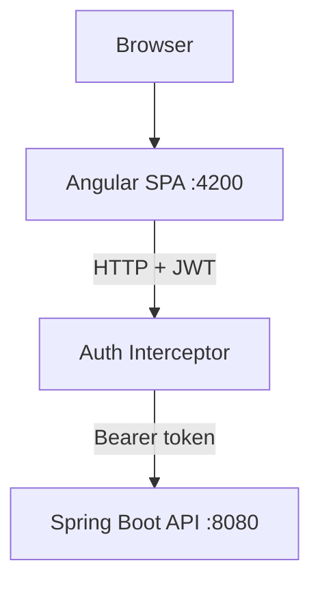
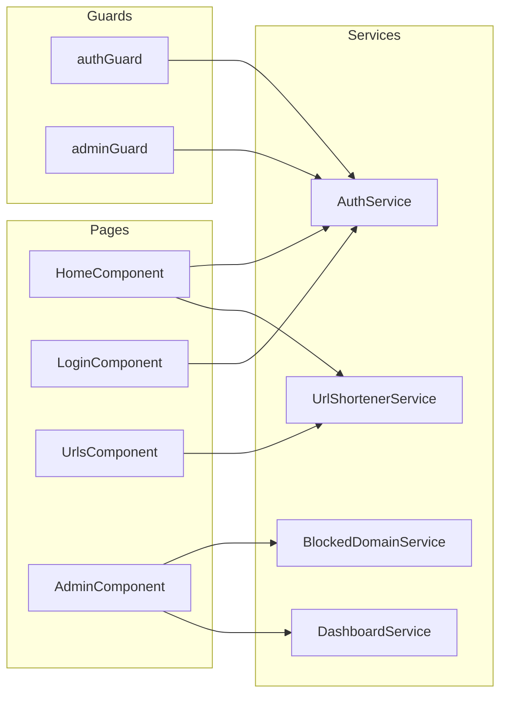
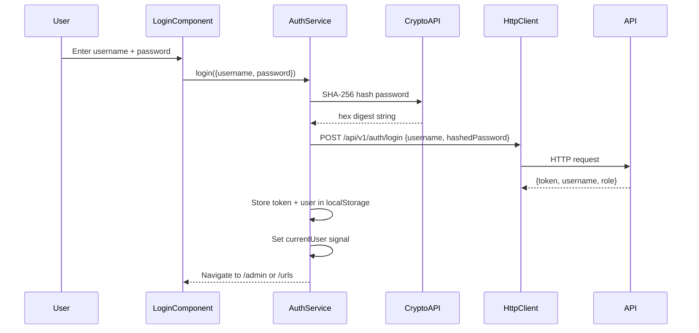

# URL Shortener UI

An Angular 17 single-page application that provides a modern frontend for the [URL Shortener API](https://github.com/AmrAGohar/url-shortener-api). It supports anonymous URL shortening, user registration and login, personal URL management, and an admin dashboard with blocked domain management.

## Table of Contents

- [Features](#features)
- [Technology Stack](#technology-stack)
- [Architecture Overview](#architecture-overview)
- [Project Structure](#project-structure)
- [Prerequisites](#prerequisites)
- [Installation and Setup](#installation-and-setup)
- [Running the Full Application](#running-the-full-application)
- [Application Pages](#application-pages)
- [Frontend Architecture](#frontend-architecture)
- [Configuration](#configuration)
- [Testing](#testing)
- [Troubleshooting](#troubleshooting)
- [Future Improvements](#future-improvements)

## Features

- **Anonymous URL Shortening** — anyone can shorten a URL from the home page without logging in; a warning shows the TTL for anonymous links
- **User Registration and Login** — toggle between sign-in and registration on a single page
- **SHA-256 Password Prehashing** — passwords are hashed with SHA-256 on the client before being sent to the API, preventing plaintext transmission
- **JWT Token Management** — tokens are stored in `localStorage` and attached to API requests via an HTTP interceptor
- **My URLs Dashboard** — authenticated users see a list of their shortened URLs
- **Admin Dashboard** — admin users see total URL count and a top-5 most-clicked URLs table
- **Blocked Domain Management** — admins can view, add, and delete blocked domain patterns
- **Tabbed Admin Interface** — admin page uses Dashboard and Blocked Domains tabs
- **Conditional Navigation** — navbar adapts based on auth state: anonymous (Home, Login), logged-in user (Home, My URLs, Logout), admin (Admin, Logout)
- **Route Guards** — `authGuard` protects `/urls`, `adminGuard` protects `/admin`
- **Reactive State** — Angular signals for all service state (loading, error, data)

## Technology Stack

| Layer        | Technology            | Version   |
|--------------|-----------------------|-----------|
| Framework    | Angular               | 17.3      |
| Language     | TypeScript            | 5.4       |
| Styling      | SCSS                  | —         |
| HTTP         | Angular HttpClient    | 17.3      |
| State        | Angular Signals       | 17.3      |
| Routing      | Angular Router        | 17.3      |
| Testing      | Jasmine + Karma       | —         |
| Build        | Angular CLI (esbuild) | 17.3      |
| Package Mgr  | npm                   | —         |

## Architecture Overview



The frontend is a standalone Angular 17 application that communicates with the backend REST API over HTTP. All components are standalone (no NgModules). State is managed with Angular signals in services, and the `authInterceptor` automatically attaches JWT tokens to outgoing requests.



## Project Structure

```
src/app/
├── app.component.ts              # Root component with conditional navbar
├── app.component.html            # Navbar with 3-way auth state (@if/@else)
├── app.component.scss            # Global app and navbar styles
├── app.config.ts                 # Providers: router, httpClient + interceptors
├── app.routes.ts                 # Route definitions with guards
├── guards/
│   ├── auth.guard.ts             # Redirects to /login if not logged in
│   └── admin.guard.ts            # Redirects to /login if not ADMIN
├── interceptors/
│   └── auth.interceptor.ts       # Attaches Bearer token to HTTP requests
├── models/
│   ├── auth.model.ts             # AuthRequest, AuthResponse interfaces
│   ├── short-url.model.ts        # CreateShortUrlRequest, ShortUrlResponse
│   ├── blocked-domain.model.ts   # BlockedDomainRequest, BlockedDomainResponse
│   └── dashboard.model.ts        # DashboardResponse, TopUrlResponse
├── pages/
│   ├── home/                     # URL shortening form + result display
│   │   ├── home.component.ts
│   │   ├── home.component.html
│   │   └── home.component.scss
│   ├── login/                    # Login/Register toggle form
│   │   ├── login.component.ts
│   │   ├── login.component.html
│   │   └── login.component.scss
│   ├── urls/                     # Authenticated user's URL list
│   │   ├── urls.component.ts
│   │   ├── urls.component.html
│   │   └── urls.component.scss
│   └── admin/                    # Admin dashboard + blocked domains (tabbed)
│       ├── admin.component.ts
│       ├── admin.component.html
│       └── admin.component.scss
└── services/
    ├── auth.service.ts           # Login, register, logout, SHA-256 hashing
    ├── url-shortener.service.ts  # Create short URL, load user's URLs
    ├── dashboard.service.ts      # Load admin dashboard data
    └── blocked-domain.service.ts # CRUD blocked domains
```

## Prerequisites

| Tool     | Required Version | Verify Command         |
|----------|------------------|------------------------|
| Node.js  | 18.13+           | `node -v`              |
| npm      | 9+               | `npm -v`               |

Angular CLI is included as a dev dependency and does not need to be installed globally.

## Installation and Setup

### 1. Clone the Repository

```bash
git clone https://github.com/AmrAGohar/url-shortener-ui.git
cd url-shortener-ui
```

### 2. Install Dependencies

```bash
npm install
```

### 3. Start the Development Server

```bash
npm start
```

This runs `ng serve` and opens the app at `http://localhost:4200`.

> If port 4200 is in use, Angular will prompt to use another port, or you can specify one:
> ```bash
> ng serve --port 4201
> ```

### 4. Backend Requirement

The UI expects the [URL Shortener API](https://github.com/AmrAGohar/url-shortener-api) to be running on `http://localhost:8080`. See the API README for setup instructions.

## Running the Full Application

Start both projects in the correct order:

1. **Start the API** (must be first):
   ```bash
   cd url-shortener-api
   mvn spring-boot:run
   ```

2. **Start the UI**:
   ```bash
   cd url-shortener-ui
   npm start
   ```

3. **Open in browser**: `http://localhost:4200`

| Service         | URL                            |
|-----------------|--------------------------------|
| Angular UI      | `http://localhost:4200`        |
| Spring Boot API | `http://localhost:8080`        |
| H2 Console      | `http://localhost:8080/h2-console` |

## Application Pages

### Home (`/`)

The landing page with the URL shortening form. Any visitor can paste a URL and get a shortened link. Anonymous users see a warning about their link's TTL and a prompt to register.

### Login (`/login`)

A combined login/register form. Toggle between modes with a link at the bottom. The form validates username (3+ chars) and password (6+ chars). On success, the user is redirected:
- **ADMIN** role -> `/admin`
- **USER** role -> `/urls`

### My URLs (`/urls`) — requires authentication

Shows a table of the authenticated user's shortened URLs with their short codes, original URLs, creation dates, and expiration dates. Protected by `authGuard`.

### Admin (`/admin`) — requires ADMIN role

A tabbed interface with two views:

- **Dashboard tab** — shows total shortened URLs count and a top-5 most-clicked URLs table
- **Blocked Domains tab** — lists all blocked domain patterns with an inline form to add new ones and delete buttons on each row

Protected by `adminGuard`.

## Frontend Architecture

### Services and State Management

Each service uses Angular signals for reactive state management:

| Service                | Signals                     | API Endpoint                       |
|------------------------|-----------------------------|------------------------------------|
| `AuthService`          | `currentUser`, `loading`, `error` | `/api/v1/auth/login`, `/register`  |
| `UrlShortenerService`  | `urls`, `loading`, `error`  | `/api/v1/short-urls`               |
| `DashboardService`     | `dashboard`, `loading`, `error` | `/api/v1/admin/dashboard`          |
| `BlockedDomainService` | `domains`, `loading`, `error` | `/api/v1/admin/blocked-domains`    |

Computed signals derive auth state:
- `isLoggedIn` — `currentUser() !== null`
- `isAdmin` — `currentUser()?.role === 'ADMIN'`
- `username` — `currentUser()?.username`

### Authentication Flow



### HTTP Interceptor

The `authInterceptor` is a functional interceptor registered in `app.config.ts`. It checks for a stored JWT token via `AuthService.getToken()` and clones the request with an `Authorization: Bearer <token>` header if one exists.

### Route Guards

| Guard        | Protects | Behavior                                    |
|--------------|----------|---------------------------------------------|
| `authGuard`  | `/urls`  | Redirects to `/login` if `isLoggedIn` is false |
| `adminGuard` | `/admin` | Redirects to `/login` if `isAdmin` is false    |

Both are functional `CanActivateFn` guards using `inject()`.

### Form Validation

- **Home page** — the URL input uses `Validators.required`; the submit button is disabled while invalid or loading
- **Login page** — uses reactive forms with `Validators.required`, `Validators.minLength(3)` for username, `Validators.minLength(6)` for password
- **Admin blocked domains** — pattern requires `minLength(2)`, reason requires `minLength(3)`

### Error and Loading States

Every service exposes `loading` and `error` signals. Components use Angular's `@if` control flow to show loading spinners, error banners, and empty states conditionally.

## Configuration

The backend API base URL is hardcoded in each service file:

| Service                | API URL                                        |
|------------------------|------------------------------------------------|
| `AuthService`          | `http://localhost:8080/api/v1/auth`            |
| `UrlShortenerService`  | `http://localhost:8080/api/v1/short-urls`      |
| `DashboardService`     | `http://localhost:8080/api/v1/admin/dashboard`  |
| `BlockedDomainService` | `http://localhost:8080/api/v1/admin/blocked-domains` |

To change the API URL, update the `apiUrl` constant in each service file. There is no environment-file-based configuration currently.

> **Limitation:** The API URL is not externalized via Angular environments. This is listed in [Future Improvements](#future-improvements).

## Testing

### Run Unit Tests

```bash
npm test
```

This runs `ng test` with Karma and Jasmine. It opens a Chrome browser window with live test results.

> **Current state:** The project has the testing framework configured (Jasmine + Karma + Chrome launcher) but no custom test specs have been written yet. The default Angular CLI test infrastructure is in place.

### Build for Production

```bash
npm run build
```

The output is generated in the `dist/` directory.

## Troubleshooting

| Problem                               | Solution                                                                                      |
|---------------------------------------|-----------------------------------------------------------------------------------------------|
| `npm install` fails                   | Ensure Node.js 18.13+ is installed. Try deleting `node_modules` and `package-lock.json`, then run `npm install` again. |
| CORS errors in browser console        | The API must be running on `localhost:8080`. Its CORS config allows origins `4200`, `4201`, `4202`. |
| Login returns "Invalid credentials"   | Make sure the backend was restarted after the SHA-256 DataSeeder change. The old database may have the plaintext-hashed admin password. |
| Page shows blank after login          | Check browser console for errors. Verify the API is running and the JWT token is stored in `localStorage` (key: `auth_token`). |
| `ng serve` port conflict              | Use `ng serve --port 4201` or kill the process using port 4200. |
| Changes not reflecting               | Angular dev server has hot reload. If it stops working, restart with `npm start`. |
| Admin page not accessible             | Only the `admin` user (or any user with `ADMIN` role) can access `/admin`. Regular users are redirected to `/login`. |

## Future Improvements

These features are **not currently implemented**:

- **Environment-based API URL** — externalize `apiUrl` via Angular environments instead of hardcoding in each service
- **Custom test specs** — write unit tests for components, services, guards, and the interceptor
- **URL copy button** — one-click copy for generated short URLs
- **Responsive design** — optimize layouts for mobile viewports
- **Dark mode** — theme toggle with CSS custom properties
- **URL expiration picker** — let authenticated users set custom expiration dates
- **Loading skeletons** — replace plain "Loading..." text with skeleton screens
- **Toast notifications** — replace inline error/success messages with toast popups
- **Pagination** — paginate the My URLs and Blocked Domains tables
- **E2E tests** — add Cypress or Playwright end-to-end tests
